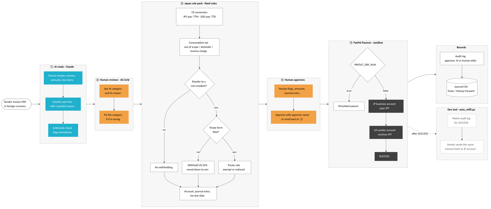

# Crossbill — Cross-border AP Agent

An AI agent that turns foreign vendor invoices into Japan-compliant payments and journal entries,
with a human approving every decision, and pays through PayPal Payouts.

> Work in progress for the PayPal AI Hackathon 2026. Full documentation will follow.



## How it works
1. **AI reads** (Claude): extracts vendor, amounts and line items, and classifies each line with a quoted reason.
2. **Human reviews** (AG Grid): checks the AI's classification and fixes it if wrong.
3. **Japan rule pack** (fixed rules, no AI): FX conversion, consumption tax, non-resident withholding
   (20.42% or treaty rate), account and journal entry, tax due date.
4. **Human approves**: reviews flags, amounts and the journal entry.
5. **PayPal Payouts** (sandbox): pays the vendor in JPY. `PAYOUT_DRY_RUN=true` simulates the payout.
6. **Records**: audit log and a journal CSV for freee / Money Forward.

## Quick start (local)
```bash
pip install -r requirements.txt
copy .env.example .env      # then fill in your keys
streamlit run app.py
```
Upload `samples/invoice_B_logo_copyright.pdf`, or `samples/invoice_B_logo_copyright.json` to skip the AI step.

## Repository layout
| Path | Purpose |
|---|---|
| `app.py` | Streamlit UI (reference implementation) |
| `extract_invoice.py` | Invoice reading with Claude (facts only, no tax decisions) |
| `japan_rules.py` | Japan rule pack: FX, consumption tax, withholding, treaty rates, journal entry |
| `paypal_client.py` | PayPal Payouts (sandbox) |
| `samples/` | Fictional invoices for the demo |
| `tools/` | Developer utilities (sample generator, sandbox balance refill) |

## Disclaimer
The tax rules in this repository are a demonstration of the approach. They are not tax advice.
Confirm every treatment with a qualified tax professional before using it for real payments.

## License
MIT
